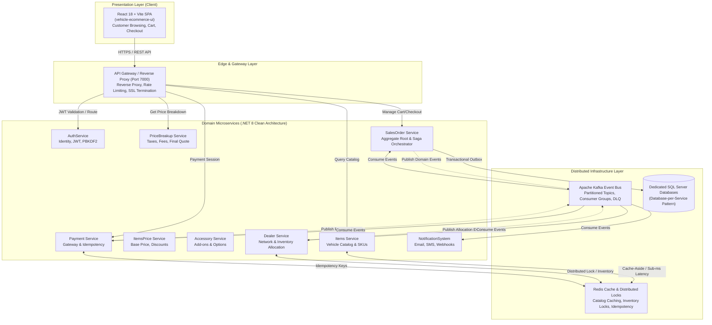
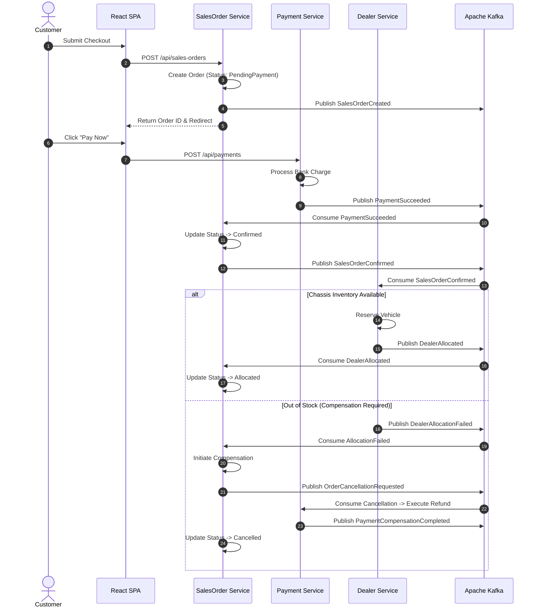

# Vehicle E-Commerce Enterprise Platform
## Comprehensive Services Architecture, Design Patterns, Redis & Apache Kafka Manual

---

## 1. System Architectural Overview

The Vehicle E-Commerce Platform is an enterprise-grade, distributed systems application designed to handle high-value automotive purchases, real-time inventory allocation, dynamic pricing breakdowns, multi-step asynchronous payment workflows, and real-time customer notifications.

### 1.1 High-Level Architecture Diagram



---

## 2. Microservices Reference Architecture

Every microservice in this platform follows the **Clean Architecture** paradigm, ensuring that business rules remain completely isolated from infrastructure, databases, third-party libraries, and UI frameworks.

---

### 2.1 AuthService (Identity & Access Management)

#### Overview
`AuthService` is the security bastion of the ecosystem. It manages customer and dealer registration, authentication, credential validation using cryptographic hashing (PBKDF2), stateless JSON Web Token (JWT) issuance, and secure refresh token rotation.

#### Why We Use It
In a distributed microservice ecosystem, business microservices (e.g., `SalesOrder`, `Dealer`, `Payment`) must remain focused strictly on their respective business domains rather than managing user accounts, passwords, salt hashes, and token generation. A dedicated authentication authority centralizes security policy enforcement, compliance, and credential lifecycle management.

#### Problem It Solves
- **Eliminates Distributed Authentication Overhead**: Downstream microservices do not need direct access to a credentials database. They independently verify cryptographic signatures on incoming JWTs using public/symmetric keys in memory within microseconds.
- **Prevents Token Hijacking**: Through single-use refresh token rotation, compromised refresh tokens are immediately detected and invalidated upon re-use.
- **Prevents Password Leakage**: Passwords are never stored in plaintext or reversible encryption; they are salted and hashed using PBKDF2 with SHA-256.

#### Advantages and Disadvantages
- **Advantages**:
  - Stateless verification: Zero database calls required by downstream services to authenticate incoming HTTP requests.
  - Granular Role-Based Access Control (RBAC): Encodes user identities, roles (`Customer`, `Dealer`, `Admin`), and permissions directly inside standard JWT claims (`sub`, `email`, `role`).
  - Independent scaling: Security traffic spikes during sales launches do not impair order processing databases.
- **Disadvantages**:
  - Stateless tokens cannot be revoked instantly prior to expiration (mitigated by short 15-minute access token lifespans).
  - Key rotation requires coordinated configuration across services or an automated JWKS (JSON Web Key Set) endpoint.

#### When to Use and When Not to Use
- **When to Use**: Whenever authenticating external human users, issuing identity assertions, performing login, registration, and refresh token handshakes.
- **When Not to Use**: Do not use this service for high-frequency internal machine-to-machine service calls where mTLS (mutual TLS) or internal network firewalls are faster and more suitable.

#### Implementation Details
- **Password Hashing**: Implements Microsoft ASP.NET Core `PasswordHasher<User>`, applying PBKDF2 with HMAC-SHA256, 128-bit salt, and 100,000 iterations.
- **Refresh Token Storage**: Refresh tokens are 64 cryptographically secure random bytes generated via `RandomNumberGenerator`. Crucially, **only the SHA-256 hash of the refresh token is stored in the database**, so even a database read leak cannot compromise active user refresh tokens.

```csharp
// Token Generation within AuthService
public TokenResponse GenerateTokens(User user)
{
    var claims = new List<Claim>
    {
        new(ClaimTypes.NameIdentifier, user.Id.ToString()),
        new(ClaimTypes.Email, user.Email),
        new(JwtRegisteredClaimNames.Jti, Guid.NewGuid().ToString())
    };
    foreach (var userRole in user.UserRoles)
        claims.Add(new Claim(ClaimTypes.Role, userRole.Role.Name));

    var key = new SymmetricSecurityKey(Encoding.UTF8.GetBytes(_configuration["Jwt:SecretKey"]!));
    var credentials = new SigningCredentials(key, SecurityAlgorithms.HmacSha256);

    var token = new JwtSecurityToken(
        issuer: _configuration["Jwt:Issuer"],
        audience: _configuration["Jwt:Audience"],
        claims: claims,
        expires: DateTime.UtcNow.AddMinutes(int.Parse(_configuration["Jwt:AccessTokenMinutes"]!)),
        signingCredentials: credentials);

    return new TokenResponse
    {
        AccessToken = new JwtSecurityTokenHandler().WriteToken(token),
        RefreshToken = GenerateSecureRandomToken(),
        AccessTokenExpiresAtUtc = DateTime.UtcNow.AddMinutes(15),
        RefreshTokenExpiresAtUtc = DateTime.UtcNow.AddDays(7)
    };
}
```

#### Real-World Use Cases
1. **User Sign-In**: A customer logs into the React frontend with email and password. `AuthService` verifies PBKDF2 hash, issues an Access Token (15-min) and Refresh Token (7-day), and returns them over HTTPS.
2. **Silent Refresh**: When the 15-minute access token expires, the client's HTTP interceptor silently invokes `POST /api/auth/refresh`. The server hashes the incoming token, finds it in `RefreshTokens`, marks it `RevokedAtUtc = UtcNow`, and issues a new pair.

#### Best Practices & Pitfalls
- **Best Practice**: Always store only the SHA-256 hash of refresh tokens in the database.
- **Common Mistake**: Putting sensitive data (credit card numbers, passwords, PII) in JWT claims. JWT payloads are Base64Url-encoded and visible to anyone who possesses the token.

---

### 2.2 Items Service (Vehicle Catalog)

#### Overview
The `Items` microservice is the system of record for the vehicle catalog. It maintains vehicle models, makes, chassis types, engine configurations, exterior/interior specifications, and SKU numbers.

#### Why We Use It
Vehicle specifications change independently of order workflows, payment processing, or customer accounts. Isolating catalog management into its own domain enables high-throughput read optimization, independent indexing, and caching.

#### Problem It Solves
- Eliminates database lock contention between high-volume customer catalog browsing and transactional order creation.
- Allows full-text search, filtering, and faceted catalog exploration without impacting sales transactional databases.

#### Advantages and Disadvantages
- **Advantages**:
  - Read-heavy workload can be scaled horizontally behind Redis caching.
  - Changes to vehicle specifications do not alter existing historic sales order line snapshots.
- **Disadvantages**:
  - Eventual consistency: When a new vehicle or trim is added, downstream services (Pricing, Dealer Inventory) must synchronize via Kafka events.

#### When to Use and When Not to Use
- **When to Use**: When browsing vehicle models, retrieving vehicle specifications, managing manufacturer SKUs, and filtering available vehicle variants.
- **When Not to Use**: Do not store pricing, tax calculations, or dealer stock levels directly within the Vehicle aggregate. Those belong to `ItemsPrice` and `Dealer`.

#### Implementation Details
- Uses EF Core with read-optimized queries (`AsNoTracking()`).
- Pairs with Redis via the **Cache-Aside Pattern**: Requests for `GET /api/items/{id}` check Redis first (`key: item:{id}`). On miss, it queries SQL Server, populates Redis with a 30-minute sliding TTL, and returns the result.

```csharp
// Items.Application/Services/ItemQueryService.cs
public async Task<ItemDto?> GetItemByIdAsync(int id, CancellationToken ct)
{
    var cacheKey = $"item:{id}";
    var cached = await _cache.GetStringAsync(cacheKey, ct);
    if (!string.IsNullOrEmpty(cached))
        return JsonSerializer.Deserialize<ItemDto>(cached);

    var item = await _db.Items
        .AsNoTracking()
        .FirstOrDefaultAsync(x => x.Id == id, ct);

    if (item is null) return null;

    var dto = ItemMapper.ToDto(item);
    await _cache.SetStringAsync(
        cacheKey, 
        JsonSerializer.Serialize(dto), 
        new DistributedCacheEntryOptions { SlidingExpiration = TimeSpan.FromMinutes(30) },
        ct);

    return dto;
}
```

#### Real-World Use Cases
- A user filters by "Make: Sedan", "Fuel: Electric" on the React vehicle catalog. `Items` service processes the query with pagination, returning 12 cards per page.

#### Best Practices & Pitfalls
- **Best Practice**: Use `AsNoTracking()` for all catalog query operations to eliminate EF Core change tracking overhead.
- **Common Mistake**: Storing mutable pricing or dealer inventory counts inside the catalog table.

---

### 2.3 ItemsPrice & ItemsPriceBreakup Services

#### Overview
- `ItemsPrice`: Maintains base pricing schedules, seasonal discounts, manufacturer rebates, and effective date ranges for vehicles.
- `ItemsPriceBreakup`: Calculates complex statutory fees, road taxes, regional registration charges, insurance slabs, and handling charges to compute the binding final invoice quote.

#### Why We Use It
Automotive pricing is complex and location-dependent: state registration charges, municipal fees, luxury vehicle tax brackets, and insurance vary dramatically by buyer location. Splitting this into specialized services allows financial formulas and tax tables to evolve without touching the vehicle catalog.

#### Problem It Solves
- Eliminates hardcoded price calculations in client or order code.
- Prevents price tampering: The frontend only presents quotes; the backend recalculates and revalidates prices authoritatively prior to order creation.

#### Advantages and Disadvantages
- **Advantages**:
  - Accurate statutory tax compliance.
  - Price schedules can be scheduled in advance with versioning (`version` property).
- **Disadvantages**:
  - Adds an extra network hop during checkout quote assembly (mitigated by caching current price schedules in Redis).

#### When to Use and When Not to Use
- **When to Use**: Calculating vehicle prices, applying promotional discounts, computing state-specific road taxes and insurance breakdowns.
- **When Not to Use**: Do not use to record payment confirmation or execute bank transactions.

#### Implementation Details
- Employs deterministic calculation models.
- Returns a structured `PriceBreakup` containing `basePrice`, `discount`, `tax`, `registrationCharges`, `insurance`, `otherCharges`, and `finalPrice`.

```csharp
// ItemsPriceBreakup.Domain/Models/PriceBreakupCalculator.cs
public static PriceBreakup Calculate(decimal basePrice, decimal discount, string stateCode)
{
    var taxableAmount = Math.Max(0, basePrice - discount);
    var taxRate = GetStateTaxRate(stateCode); // e.g., 0.18 for 18% GST
    var tax = Math.Round(taxableAmount * taxRate, 2);
    var registration = CalculateRegistration(taxableAmount, stateCode);
    var insurance = CalculateInsurance(taxableAmount);
    var otherCharges = 500.00m; // Documentation & handling

    var finalPrice = taxableAmount + tax + registration + insurance + otherCharges;

    return new PriceBreakup(basePrice, discount, tax, registration, insurance, otherCharges, finalPrice, "INR");
}
```

#### Real-World Use Cases
- During checkout on the React UI, the customer selects state "KA" (Karnataka). The UI calls `GET /api/price-breakups/current/{itemId}`. The service returns the exact itemized cost breakdown including road tax and insurance.

#### Best Practices & Pitfalls
- **Best Practice**: Always re-execute price breakup validation inside `SalesOrder` service at the exact instant an order is submitted to prevent stale price checkouts.
- **Common Mistake**: Relying on prices passed from client-side POST bodies.

---

### 2.4 Accessory Service

#### Overview
The `Accessory` microservice manages vehicle add-ons, modifications, and accessories (e.g., roof racks, alloy wheels, floor mats, extended warranties). It manages accessory catalog data, pricing, and vehicle compatibility rules.

#### Why We Use It
Vehicle accessories have distinct lifecycles, suppliers, warranties, and stock constraints compared to whole vehicle chassis.

#### Problem It Solves
Prevents incompatible add-ons from being purchased for vehicle models that cannot physically support them (e.g., diesel exhaust tips on an electric vehicle).

#### Advantages and Disadvantages
- **Advantages**: Accessories can be searched and managed independently. Compatibility matrix is encapsulated within this domain.
- **Disadvantages**: Multi-line orders require validating accessory IDs against vehicle IDs.

#### Implementation Details
- Exposes `GET /api/accessories/item/{itemId}` to return all active, compatible accessories for a given vehicle.

---

### 2.5 Dealer Service (Network & Inventory Allocation)

#### Overview
The `Dealer` microservice manages authorized dealer franchises, geographic physical locations, showroom capacity, and chassis inventory allocation.

#### Why We Use It
Automotive sales require physical dealer handover, local DMV registration, and physical vehicle preparation (PDI - Pre-Delivery Inspection). Allocating a specific vehicle from dealer inventory is a distinct business capability.

#### Problem It Solves
- Prevents double-booking of physical vehicle inventory across concurrent buyers.
- Enforces distributed reservation and release workflows when orders succeed or cancel.

#### Advantages and Disadvantages
- **Advantages**:
  - Thread-safe inventory reservation using Redis distributed locks (`Redlock`).
  - Asynchronous event participation in Order Sagas.
- **Disadvantages**:
  - Requires compensation events (`DealerReleaseCompleted`) if downstream payment fails.

#### Implementation Details
- Exposes `GET /api/dealers/available?itemId={itemId}`.
- Listens to Kafka topic `salesorder.events` for `SalesOrderConfirmed`. Allocates chassis and publishes `DealerAllocated` event.

---

### 2.6 SalesOrder Service (Core Domain & Saga Orchestrator)

#### Overview
The `SalesOrder` microservice is the central domain of the platform. It manages the entire sales order lifecycle from `Draft`, `PendingPayment`, `Confirmed`, `Allocated`, `Processing`, to `Completed` or `Cancelled`. It acts as the **Saga Orchestrator** for multi-service transactions.

#### Why We Use It
A vehicle purchase involves multiple autonomous microservices (Pricing, Inventory, Payment, Notification). The `SalesOrder` service coordinates these steps, maintaining data consistency without distributed two-phase locking.

#### Problem It Solves
- Solves distributed consistency using the **Saga Pattern** and **Transactional Outbox Pattern**.
- Prevents partial failures (e.g., payment processed but dealer inventory failed) by coordinating compensating rollback actions.

#### Advantages and Disadvantages
- **Advantages**:
  - Implements complete audit history in `SalesOrderHistory`.
  - Guaranteed message publishing via Transactional Outbox.
  - Zero lost updates or ghost orders.
- **Disadvantages**:
  - Requires eventual consistency mindset and state machine transitions.

#### Implementation Details
- Manages `SalesOrder` aggregate root.
- Uses `EfUnitOfWork` for transactional boundaries.
- Emits integration events to `salesorder.events` via `EfOutboxWriter`.

---

### 2.7 Payment Service

#### Overview
The `Payment` microservice interfaces with external payment gateways (Stripe, Razorpay, Bank Transfer). It handles payment initiation, webhook verification, refunds, and idempotency guarantees.

#### Why We Use It
Payment integration requires strict PCI-DSS compliance boundaries, sensitive credential isolation, and strict idempotency enforcement.

#### Problem It Solves
- Prevents duplicate credit card charges or double-payment when network timeouts cause client retries.
- Enforces asynchronous compensation (refunds) if subsequent order allocation fails.

#### Implementation Details
- Mandates an `Idempotency-Key` header on every `POST /api/payments` request.
- Stores payment intent state in SQL Server and Redis to short-circuit duplicate submissions.
- Publishes `PaymentSucceeded` or `PaymentFailed` events to Kafka.

---

### 2.8 NotificationSystem Service

#### Overview
The `NotificationSystem` microservice is a purely event-driven service that consumes Kafka domain events and sends automated emails, SMS notifications, and push notifications to customers and dealership agents.

#### Why We Use It
Customer communication must never block or slow down core transactional order processing. If an SMTP server or SMS gateway is slow or down, the order must still complete successfully.

#### Problem It Solves
Decouples external communication I/O latency and failure modes from transactional workflows.

#### Implementation Details
- Subscribes to `salesorder.events`, `payment.events`, and `dealer.events`.
- Formats email templates and dispatches messages with background retry policies.

---

### 2.9 Vehicle Ecommerce UI (React 18 + Vite SPA)

#### Overview
The modern customer-facing Single Page Application (SPA) built with React 18, TypeScript, TanStack Query, React Hook Form, and Zod.

#### Why We Use It
Provides a fast, responsive, and visually stunning client interface for vehicle browsing, custom configuration, shopping cart, checkout, payment redirection, and real-time order tracking.

#### Problem It Solves
- **Separation of Presentation & Business Authority**: The frontend handles presentation and client orchestration, while all business authority (pricing, inventory, order state transitions) remains securely enforced by the .NET backend.
- **Resilient UI States**: Fully handles loading skeletons, empty states, validation errors, and network retry states across all views.

---

## 3. Design Patterns & Architectural Paradigms

---

### 3.1 Clean Architecture / Onion Architecture

#### Overview
Clean Architecture organizes the codebase into concentric layers with a strict **Dependency Rule**: *dependencies must only point inward toward higher-level business policies*.
1. **Domain Layer**: Core Entities, Aggregate Roots, Enums, Value Objects (Zero dependencies).
2. **Application Layer**: Use cases, CQRS Commands/Queries, DTOs, Service Interfaces.
3. **Infrastructure Layer**: EF Core DbContext, Repositories, Kafka Producers/Consumers, Redis clients.
4. **API Layer**: ASP.NET Core Controllers, Middlewares, Dependency Injection container.

#### Why We Use It
Prevents enterprise software from degenerating into a "big ball of mud" where database queries and HTTP concerns are tangled into business rules.

#### Problem It Solves
- Database or library upgrades can be performed in the Infrastructure layer without touching a single line of domain business logic.
- Domain logic is 100% unit-testable without mocking HTTP contexts or databases.

#### Advantages and Disadvantages
- **Advantages**: Extreme maintainability, clean test boundaries, technology independence.
- **Disadvantages**: Introduces multiple projects and mapping boilerplate between Domain Entities and Application DTOs.

---

### 3.2 The Transactional Outbox Pattern

#### Overview
The Transactional Outbox pattern guarantees that a database update and its corresponding integration event are saved **within the exact same local ACID database transaction**. A separate background process or message relay then reads the outbox table and publishes events to Apache Kafka with guaranteed at-least-once delivery.

#### Why We Use It
In distributed systems, the "Dual Write" problem is catastrophic: if an application updates the database and then attempts to publish a message directly to Kafka over the network, a network blip or process crash after the DB commit leaves the system inconsistent.

#### Problem It Solves
- Eliminates ghost updates and missing events.
- Avoids expensive and fragile Two-Phase Commit (2PC) / distributed transactions (XA).

#### Implementation Details in Our Solution
In `SalesOrder.Infrastructure/Messaging/EfOutboxWriter.cs`:
```csharp
public sealed class EfOutboxWriter : IOutboxWriter
{
    private readonly SalesOrderDbContext _db;
    public EfOutboxWriter(SalesOrderDbContext db) => _db = db;

    public Task AddAsync(string eventType, string aggregateId, object payload, CancellationToken ct)
    {
        var topic = eventType switch
        {
            "SalesOrderCreated" or "SalesOrderConfirmed" or
            "SalesOrderCancelled" or "SalesOrderStatusChanged"
                => "salesorder.events",
            "OrderCancellationRequested" => "order.cancellation.commands",
            _ => throw new InvalidOperationException($"No topic configured for '{eventType}'.")
        };

        var message = new OutboxMessage
        {
            EventId = Guid.NewGuid(),
            AggregateId = aggregateId,
            EventType = eventType,
            Topic = topic,
            PayloadJson = JsonSerializer.Serialize(payload),
            CreatedAtUtc = DateTime.UtcNow
        };

        _db.OutboxMessages.Add(message);
        return Task.CompletedTask;
    }
}
```

---

### 3.3 The Saga Pattern (Distributed Transactions)

#### Overview
A Saga is a sequence of local transactions where each service updates its local database and publishes an event or message. If a local transaction fails, the Saga executes **compensating transactions** that undo the changes made by the preceding transactions.

#### Why We Use It
Traditional distributed ACID transactions (Two-Phase Commit) do not scale across independent microservices and lock database rows across network boundaries. Sagas achieve eventual consistency without blocking.

#### Implementation in Our Platform: Order Lifecycle Saga


---

### 3.4 Idempotent Consumer Pattern

#### Overview
The Idempotent Consumer pattern ensures that processing a duplicate message multiple times produces the exact same outcome as processing it once, without unintended side effects.

#### Why We Use It
Apache Kafka provides **at-least-once** delivery guarantees. Network retries or rebalances can cause a consumer to receive the exact same event multiple times.

#### Problem It Solves
Prevents duplicate financial charges, double-deductions of dealer inventory, and duplicate order creation.

#### Implementation Details in Our Solution
In `DealerAllocatedHandler.cs`:
```csharp
await using var tx = await _db.Database.BeginTransactionAsync(ct);

// 1. Check if event was already processed
if (await _db.ProcessedIntegrationEvents.AnyAsync(
    x => x.ConsumerName == Consumer && x.EventId == eventId, ct))
{
    // Idempotent exit: commit and return immediately
    await tx.CommitAsync(ct);
    return;
}

// 2. Perform business transition
order.ChangeStatus(SalesOrderStatus.Allocated);

// 3. Record event ID in ProcessedIntegrationEvents table in the same transaction
_db.ProcessedIntegrationEvents.Add(new ProcessedIntegrationEvent
{
    ConsumerName = Consumer,
    EventId = eventId,
    ProcessedAtUtc = DateTime.UtcNow
});

await _db.SaveChangesAsync(ct);
await tx.CommitAsync(ct);
```

---

### 3.5 Dead Letter Queue / Dead Letter Topic (DLQ / DLT) Pattern

#### Overview
When a consumer encounters a malformed payload or permanent unrecoverable exception ("poison pill"), attempting to retry indefinitely will block the entire partition. The DLQ pattern catches the poison message, attaches error diagnostic metadata in Kafka headers, publishes the message to a dedicated `.dlq` topic, and commits the original consumer offset to allow processing to continue.

#### Implementation in Our Solution
In `SalesOrder.Infrastructure/Messaging/KafkaDeadLetterPublisher.cs`:
```csharp
public async Task PublishAsync(ConsumeResult<string, string> record, Exception error, CancellationToken ct)
{
    var dlqTopic = $"{record.Topic}.dlq";
    var headers = new Headers();

    if (record.Message.Headers is not null)
    {
        foreach (var header in record.Message.Headers)
            headers.Add(header.Key, header.GetValueBytes());
    }

    headers.Add("original-topic", Encoding.UTF8.GetBytes(record.Topic));
    headers.Add("original-partition", Encoding.UTF8.GetBytes(record.Partition.Value.ToString()));
    headers.Add("original-offset", Encoding.UTF8.GetBytes(record.Offset.Value.ToString()));
    headers.Add("failure-type", Encoding.UTF8.GetBytes(error.GetType().FullName ?? "Exception"));
    headers.Add("failure-message", Encoding.UTF8.GetBytes(error.Message[..Math.Min(1000, error.Message.Length)]));

    await _producer.ProduceAsync(
        dlqTopic,
        new Message<string, string>
        {
            Key = record.Message.Key,
            Value = record.Message.Value,
            Headers = headers
        },
        ct);
}
```

---

### 3.6 Repository Pattern & Unit of Work

#### Overview
- **Repository Pattern**: Mediates between the domain and data mapping layers, acting like an in-memory collection of domain objects.
- **Unit of Work Pattern**: Maintains a list of business objects affected by a business transaction and coordinates writing out changes within a single atomic database transaction.

#### Implementation in Our Solution
In `SalesOrder.Infrastructure/Persistence/EfUnitOfWork.cs`:
```csharp
public sealed class EfUnitOfWork : IUnitOfWork, IAsyncDisposable
{
    private readonly SalesOrderDbContext _db;
    private IDbContextTransaction? _transaction;

    public EfUnitOfWork(SalesOrderDbContext db) => _db = db;

    public async Task BeginTransactionAsync(CancellationToken ct)
    {
        if (_transaction is not null)
            throw new InvalidOperationException("A transaction is already active.");
        _transaction = await _db.Database.BeginTransactionAsync(ct);
    }

    public Task<int> SaveChangesAsync(CancellationToken ct) => _db.SaveChangesAsync(ct);

    public async Task CommitTransactionAsync(CancellationToken ct)
    {
        if (_transaction is null) throw new InvalidOperationException("No active transaction.");
        await _db.SaveChangesAsync(ct);
        await _transaction.CommitAsync(ct);
        await _transaction.DisposeAsync();
        _transaction = null;
    }

    public async Task RollbackTransactionAsync(CancellationToken ct)
    {
        if (_transaction is null) return;
        await _transaction.RollbackAsync(ct);
        await _transaction.DisposeAsync();
        _transaction = null;
    }

    public async ValueTask DisposeAsync()
    {
        if (_transaction is not null) await _transaction.DisposeAsync();
    }
}
```

---

## 4. Apache Kafka Architecture & Deep Dive

Apache Kafka is the distributed event streaming backbone of the Vehicle E-Commerce ecosystem.

### 4.1 Internal Working Mechanisms
- **Append-Only Commit Log**: Kafka topics are split into partitions, each being an ordered, immutable sequence of records continuously appended to disk.
- **Sequential Disk I/O & Page Cache**: Kafka avoids JVM garbage collection overhead and random disk seek latency by relying directly on the operating system Kernel Page Cache. Sequential writes achieve throughput comparable to network line speeds.
- **Zero-Copy Data Transfer (`sendfile`)**: When transferring log data from broker to consumer network sockets, Kafka uses the Linux `sendfile()` system call. Data is copied directly from OS page cache to the network NIC buffer without copying into user-space memory, bypassing CPU copying.

```
Standard Read:
Disk -> OS Cache -> User Space JVM -> Socket Buffer -> NIC Buffer (4 context switches, 3 copies)

Kafka Zero-Copy:
Disk -> OS Page Cache ────────────[sendfile()]────────────► NIC Buffer (2 context switches, 0 CPU copies)
```

### 4.2 Core Kafka Concepts
1. **Brokers & Cluster**: A Kafka cluster consists of multiple broker nodes coordinated via KRaft (Kafka Raft metadata mode) or ZooKeeper.
2. **Topics & Partitions**:
   - A topic is a logical category of messages.
   - Partitions allow horizontal scaling: each partition can be hosted on a separate broker.
   - **Ordering Guarantee**: Kafka strictly guarantees message order **only within a single partition**, never across multiple partitions. Therefore, our platform uses `SalesOrderId` or `VehicleId` as the Kafka message **Key**. All events for a specific vehicle or order are guaranteed to route to the exact same partition.
3. **Consumer Groups & Parallelism**:
   - Consumers belong to named consumer groups (e.g., `SalesOrderServiceGroup`, `NotificationGroup`).
   - Each partition in a topic is consumed by exactly one consumer instance within a group at any given time.
   - If partitions = 6, you can run up to 6 consumer instances in parallel. A 7th consumer would sit idle as a standby.
4. **Offsets & Commit Strategies**:
   - The offset is an integer uniquely identifying each record in a partition.
   - Automatic commit (`enable.auto.commit = true`) risks message loss if a crash occurs during processing. Our production consumers use **manual offset commit** after the local database transaction successfully commits.

### 4.3 Message Delivery Guarantees
- **At-Most-Once**: Message is committed before processing. Crashes lead to lost messages.
- **At-Least-Once (Platform Standard)**: Message is processed and saved to the DB, then offset is committed. Crashes lead to duplicate delivery (handled by our Idempotent Consumer pattern).
- **Exactly-Once Semantics (EOS)**: Achieved using Kafka Transactional Producers (`isolation.level = read_committed`) combined with idempotent consumers.

### 4.4 Topic Topology & Message Matrix

| Topic Name | Key | Event Type | Producer | Consumers |
| :--- | :--- | :--- | :--- | :--- |
| `salesorder.events` | `SalesOrderId` | `SalesOrderCreated`<br>`SalesOrderConfirmed`<br>`SalesOrderAllocated`<br>`SalesOrderCancelled` | SalesOrder Service | Payment, Dealer, NotificationSystem |
| `payment.events` | `SalesOrderId` | `PaymentSucceeded`<br>`PaymentFailed`<br>`PaymentCompensationCompleted` | Payment Service | SalesOrder, NotificationSystem |
| `dealer.events` | `SalesOrderId` | `DealerAllocated`<br>`DealerAllocationFailed`<br>`DealerReleaseCompleted` | Dealer Service | SalesOrder, NotificationSystem |
| `*.dlq` | `Original Key` | Poison pill records with diagnostic headers | Any Consumer | DevOps Alerting, Dead-Letter Monitor |

---

## 5. Redis Architecture & Distributed Caching Deep Dive

Redis (Remote Dictionary Server) is an in-memory, ultra-low latency key-value data structure store used for caching, distributed locking, and short-lived state coordination.

### 5.1 Architecture & Single-Threaded Event Loop
- Redis executes commands on a **single-threaded event loop using non-blocking I/O multiplexing (`epoll` / `kqueue`)**.
- Because all commands execute on a single thread, **individual Redis commands (`SET`, `INCR`, `HSET`, `ZADD`) are atomic by definition**, eliminating multi-threaded race conditions inside the cache server.

### 5.2 Caching Strategies in the Platform

1. **Cache-Aside (Lazy Loading - Used in Catalog & Pricing)**:
   - Application queries Redis first (`item:105`).
   - **Cache Hit**: Data returned in sub-millisecond time.
   - **Cache Miss**: Application queries SQL Server, serializes result into Redis with a 30-minute TTL, and returns data.
   - *Resilience*: If Redis goes down, the application continues functioning by querying the primary database directly.

2. **Write-Through**:
   - Cache and database are updated simultaneously on write. Eliminates stale reads at the cost of higher write latency.

3. **Write-Behind (Write-Back)**:
   - Writes go directly to Redis; Redis batches updates to SQL Server asynchronously. High write throughput, but risks data loss on sudden power failure.

4. **Refresh-Ahead**:
   - Background worker proactively refreshes cached hot vehicle models before their TTL expires based on access patterns.

### 5.3 Data Structures in Our Platform

| Structure | Example Commands | Platform Microservice Usage |
| :--- | :--- | :--- |
| **Strings** | `SET`, `GET`, `SETEX` | Cached JSON for vehicle specs, pricing quotes, and JWT blacklist flags. |
| **Hashes** | `HSET`, `HGETALL`, `HINCRBY` | Real-time vehicle chassis inventory per dealer: `HSET dealer:102 inventory:sku:501 4`. |
| **Sorted Sets (ZSET)**| `ZADD`, `ZRANGEBYSCORE` | Filter vehicles by price range or rank top-selling models by booking volume. |
| **Sets** | `SADD`, `SMEMBERS`, `SISMEMBER` | Distinct vehicle trim options, available colors, and user role permission scopes. |
| **Streams** | `XADD`, `XREADGROUP` | High-throughput in-memory audit logs and telemetry tracking before Kafka persistence. |

### 5.4 Expiration Policies & Eviction Mechanisms
- **TTL (Time-To-Live)**: Keys are configured with expiration. Redis cleans them using:
  - *Passive Expiration*: Expired key is deleted when accessed.
  - *Active Expiration*: Background thread samples 20 random keys with TTLs every 100ms and deletes expired ones.
- **MaxMemory Eviction Policies**:
  - `volatile-lru`: Evicts least-recently-used keys that have an explicit TTL.
  - `allkeys-lru`: Evicts least-recently-used keys across all keys (ideal for catalog caches).
  - `noeviction`: Returns an out-of-memory error on new writes (used for mission-critical distributed lock instances).

### 5.5 Distributed Locking with Redlock
When allocating limited vehicle chassis or promotional booking slots, multiple requests must not reserve the last chassis simultaneously:
```csharp
// Distributed Lock Acquisition in Dealer Service
var lockKey = $"lock:allocation:item:{itemId}";
var lockValue = Guid.NewGuid().ToString();
var acquired = await _redisDb.StringSetAsync(
    lockKey, 
    lockValue, 
    TimeSpan.FromSeconds(15), 
    When.NotExists);

if (!acquired)
{
    throw new ConcurrencyException("Another customer is currently reserving this vehicle. Please retry in 10 seconds.");
}

try
{
    // Execute critical chassis allocation in database
    await AllocateChassisAsync(dealerId, itemId);
}
finally
{
    // Safe atomic release via Lua script (verifying lockValue matches owner)
    const string luaReleaseScript = @"
        if redis.call('get', KEYS[1]) == ARGV[1] then
            return redis.call('del', KEYS[1])
        else
            return 0
        end";
    await _redisDb.ScriptEvaluateAsync(luaReleaseScript, new RedisKey[] { lockKey }, new RedisValue[] { lockValue });
}
```

---

## 6. End-to-End Walkthrough: The Life of a Vehicle Purchase

```
1. Customer Browsing:
   - React UI requests GET /api/items?make=Tesla&pageSize=12.
   - Items service checks Redis. On miss, queries SQL Server and caches result.
   - UI renders vehicle cards with prices formatted in INR.

2. Price Calculation:
   - Customer opens Vehicle Details page.
   - UI calls GET /api/price-breakups/current/101.
   - PriceBreakup service calculates base, tax (18%), state registration, insurance.

3. Order Submission (Saga Begins):
   - Customer submits checkout with Dealer ID.
   - SalesOrder service executes local ACID transaction:
     a. Creates SalesOrder (Status: PendingPayment).
     b. Inserts SalesOrderCreated into OutboxMessages table.
   - Outbox processor picks up record and publishes to Kafka topic 'salesorder.events'.

4. Payment Processing:
   - UI navigates customer to Payment Page.
   - Customer clicks "Pay Now" with Idempotency-Key.
   - Payment service verifies charge with bank gateway.
   - Inserts PaymentSucceeded into outbox and publishes to 'payment.events'.

5. Order Confirmation & Allocation:
   - SalesOrder consumer receives PaymentSucceeded:
     a. Checks ProcessedIntegrationEvents (Idempotency).
     b. Updates order to Confirmed.
     c. Writes SalesOrderConfirmed to Outbox.
   - Dealer Service consumer receives SalesOrderConfirmed:
     a. Acquires Redis distributed lock for vehicle inventory.
     b. Allocates physical chassis number.
     c. Publishes DealerAllocated to 'dealer.events'.

6. Completion & Notification:
   - SalesOrder consumer receives DealerAllocated -> changes order status to Allocated.
   - NotificationSystem receives event -> dispatches automated confirmation email and SMS with delivery date.
   - Customer views live status updates on OrderTimeline component in React UI.
```

---

## 7. Operational & Production Checklist

1. **Kafka Cluster Provisioning**:
   - `min.insync.replicas = 2` and `replication.factor = 3` on all production event topics.
   - Enable `enable.idempotence = true` on all .NET Confluent.Kafka producers.
2. **Redis Production Configuration**:
   - Configure `appendonly yes` (AOF) with `appendfsync everysec` alongside RDB snapshots.
   - Set `maxmemory-policy allkeys-lru` for catalog cache, or use a dedicated Redis instance for distributed locks with `noeviction`.
3. **Database Consistency**:
   - Run EF Core database migrations via CI/CD idempotent SQL scripts, never runtime `Database.Migrate()`.
4. **Idempotency Everywhere**:
   - Every Kafka consumer MUST check `ProcessedIntegrationEvents` before mutating domain state.
   - Every payment POST endpoint MUST mandate `Idempotency-Key` headers.

---
*Vehicle E-Commerce Enterprise Platform — Engineering Architecture & Microservices Manual*
