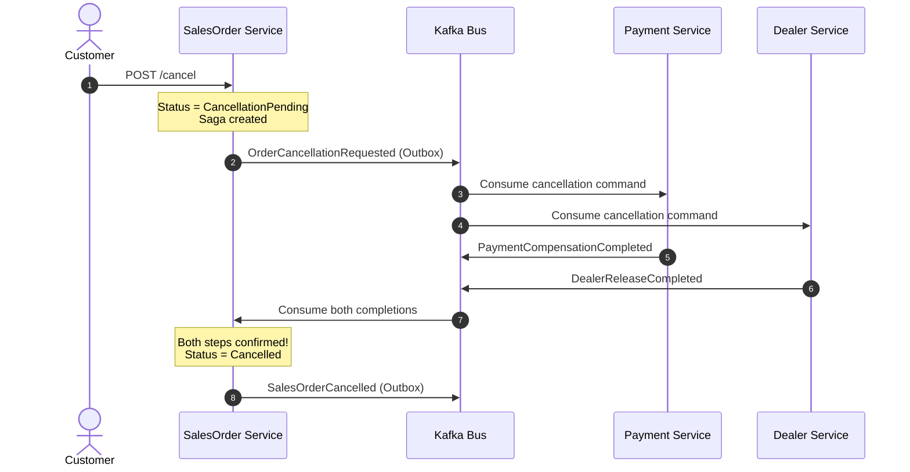

# Vehicle E-Commerce Microservices Platform
## System Architecture, Design Patterns, Technologies & Microservices Manual

---

## 1. System Architectural Overview

The **Vehicle E-Commerce Platform** is a distributed, enterprise-grade cloud-native solution designed for vehicle browsing, customized pricing, accessory selection, dealer stock allocation, order checkout, payment processing, and event notifications. 

The system implements **Domain-Driven Design (DDD)** and **Clean Architecture** across all services, combined with **Apache Kafka** for asynchronous, event-driven integration and **Redis** for distributed caching and state management.

```
                              ┌─────────────────────────────────────────┐
                              │           Client Applications           │
                              │    (React SPA / Mobile / Dealer Web)    │
                              └────────────────────┬────────────────────┘
                                                   │
                                            HTTPS / REST
                                                   ▼
                              ┌─────────────────────────────────────────┐
                              │            API Gateway (YARP)           │
                              │   SSL Termination / JWT Relay / Rate    │
                              └──────┬──────────────┬─────────────┬─────┘
                                     │              │             │
                    ┌────────────────┼──────────────┼─────────────┼────────────────┐
                    ▼                ▼              ▼             ▼                ▼
             ┌─────────────┐  ┌─────────────┐ ┌───────────┐ ┌───────────┐   ┌─────────────┐
             │ AuthService │  │Items Catalog│ │Items Price│ │ Accessory │   │ SalesOrder  │
             └──────┬──────┘  └──────┬──────┘ └─────┬─────┘ └─────┬─────┘   └──────┬──────┘
                    │                │              │             │                │
            SQL Server (Auth)   SQL Server      SQL Server    SQL Server      SQL Server
                    │                │              │             │                │
                    │                └──────┬───────┴─────────────┴────────────────┤
                    ▼                       ▼                                      ▼
             ┌─────────────┐         ┌─────────────┐                        ┌─────────────┐
             │ Redis Cache │         │ Apache Kafka│ ◄──────────────────────┤  Outbox     │
             │ Distributed │         │ Event Bus   │                        │  Publisher  │
             └─────────────┘         └──────┬──────┘                        └─────────────┘
                                            │
                             ┌──────────────┴──────────────┐
                             ▼                             ▼
                      ┌─────────────┐               ┌─────────────┐
                      │   Dealer    │               │   Payment   │
                      │ Allocation  │               │ Integration │
                      └──────┬──────┘               └──────┬──────┘
                             │                             │
                         SQL Server                    SQL Server
```

---

## 2. Microservices Reference Architecture

Each service in the solution is structured into four explicit layers following **Clean Architecture**:
- **API Layer**: ASP.NET Core 8 Web API, Controllers, Middleware, Dependency Injection configuration, and Swagger documentation.
- **Application Layer**: Commands, Queries, DTOs, Service interfaces, Validators, and Orchestration services.
- **Domain Layer**: Core Business Entities, Aggregate Roots, Enums, Value Objects, and Domain Exceptions (zero framework dependencies).
- **Infrastructure Layer**: Entity Framework Core `DbContext`, Database Migrations, Repository implementations, Kafka Producers/Consumers, and external API integrations.

---

### 2.1 AuthService (Identity & Access Management)

#### Overview
The `AuthService` is the central security boundary of the platform. It handles identity management, secure user registration, password hashing with PBKDF2, JWT access token generation, and cryptographically secure refresh token rotation.

#### Why We Use It
In a distributed microservice ecosystem, user authentication must not be duplicated across individual business services. A dedicated identity service issues cryptographically signed, stateless tokens that any downstream service can independently verify without querying a central database.

#### Problem It Solves
- Eliminates sticky sessions and centralized session bottleneck.
- Protects downstream microservices from database queries solely for identity checks.
- Prevents stolen token reuse by implementing single-use refresh token rotation.

#### Advantages and Disadvantages
- **Advantages**:
  - Stateless verification via public/symmetric keys across microservices.
  - High performance: downstream services validate tokens in-memory in microseconds.
  - Fine-grained Role-Based Access Control (RBAC) via claims (`Customer`, `Dealer`, `Admin`).
- **Disadvantages**:
  - Stateless access tokens cannot be instantly revoked until their short lifetime expires (mitigated by 15-minute access token windows).
  - Key rotation requires synchronization across all services.

#### When to Use and When Not to Use
- **When to Use**: All external and internal authentication, client session handling, and privilege issuance.
- **When Not to Use**: Internal inter-service synchronization where mTLS or service mesh identities (SPIFFE) are more suitable.

#### Implementation Details
- **Password Hashing**: Utilizes ASP.NET Core's `PasswordHasher<User>`, applying PBKDF2 with HMAC-SHA256 and cryptographic salting. Plaintext passwords never touch persistence.
- **Access Tokens**: Short-lived (15 minutes) signed using HMAC-SHA256 (`HmacSha256`) containing `sub`, `email`, `role`, and unique `jti`.
- **Refresh Tokens**: Long-lived (7 days), generated with 64 cryptographically secure random bytes (`RandomNumberGenerator`). Stored **only in hashed form (SHA-256)** in the database to prevent token leakage in case of database compromise.

```csharp
// AuthService.Infrastructure/Security/TokenService.cs
public TokenResponse GenerateTokens(User user)
{
    var claims = new List<Claim>
    {
        new(ClaimTypes.NameIdentifier, user.Id.ToString()),
        new(ClaimTypes.Email, user.Email),
        new(JwtRegisteredClaimNames.Jti, Guid.NewGuid().ToString())
    };
    foreach (var userRole in user.UserRoles)
        claims.Add(new Claim(ClaimTypes.Role, userRole.Role.Name));

    var key = new SymmetricSecurityKey(Encoding.UTF8.GetBytes(_configuration["Jwt:SecretKey"]!));
    var credentials = new SigningCredentials(key, SecurityAlgorithms.HmacSha256);

    var token = new JwtSecurityToken(
        issuer: _configuration["Jwt:Issuer"],
        audience: _configuration["Jwt:Audience"],
        claims: claims,
        expires: DateTime.UtcNow.AddMinutes(int.Parse(_configuration["Jwt:AccessTokenMinutes"]!)),
        signingCredentials: credentials);

    return new TokenResponse
    {
        AccessToken = new JwtSecurityTokenHandler().WriteToken(token),
        RefreshToken = GenerateRefreshToken(),
        AccessTokenExpiresAtUtc = DateTime.UtcNow.AddMinutes(15),
        RefreshTokenExpiresAtUtc = DateTime.UtcNow.AddDays(7)
    };
}
```

#### Real-World Use Cases
- A customer logs in via the React web frontend, receives an Access Token (15 min) and Refresh Token (7 days).
- When the Access Token expires, the client calls `POST /api/auth/refresh` with the refresh token. The server hashes the incoming token, finds it in `RefreshTokens`, checks `IsActive`, invalidates it (`RevokedAtUtc`), and issues a new pair.

#### Best Practices & Pitfalls
- **Best Practice**: Always store only the SHA-256 hash of refresh tokens in `AuthDbContext`.
- **Common Mistake**: Storing raw refresh tokens in the database or placing secrets/passwords inside JWT claims.

---

### 2.2 Items Service (Vehicle Catalog)

#### Overview
The `Items` microservice manages the vehicle catalog aggregate root: Make, Model, Variant, Category, and specific vehicle SKUs. It acts as the system of record for vehicle specifications.

#### Why We Use It
Separates catalog browsing and inventory specifications from pricing, order processing, and manufacturing operations.

#### Problem It Solves
Vehicle configurations (e.g., Engine, Variant, Transmission, Category) change independently of sales operations. Dedicating a microservice ensures catalog searches do not impact order transactional databases.

#### Advantages and Disadvantages
- **Advantages**: Independently scalable for heavy read traffic (catalog browsing). Emits events (`vehicle.created`) to keep downstream pricing and inventory stores updated.
- **Disadvantages**: Eventual consistency between new vehicle creation and price association.

#### Implementation Details
- Enforces SKU uniqueness at the database level.
- Emits `vehicle.created` event via `IEventPublisher` (`KafkaEventPublisher`) using idempotent producer configuration (`Acks.All`, `EnableIdempotence = true`).

```csharp
// Items.Application/Services/ItemApplicationService.cs
var vehicleCreatedEvent = new VehicleCreatedEvent(
    item.Id, item.SKU, item.Name, item.VehicleMakeId, item.VehicleModelId,
    item.VehicleVariantId, item.VehicleCategoryId, now);

await _eventPublisher.PublishAsync("vehicle.created", vehicleCreatedEvent, cancellationToken);
```

---

### 2.3 ItemsPrice & ItemsPriceBreakup Services

#### Overview
- `ItemsPrice`: Manages base vehicle prices, effective date windows (`EffectiveFromUtc`, `EffectiveToUtc`), and active price versions.
- `ItemsPriceBreakup`: Calculates the granular financial breakdown: Ex-Showroom price, Road Tax (RTO), Motor Insurance, Handling/Logistics fees, and State GST.

#### Why We Use It
Automotive pricing is complex and location-dependent. Separating base prices from tax and breakup rules allows finance teams to update tax brackets (e.g., GST changes or state road tax slabs) without modifying vehicle inventory models.

#### Problem It Solves
Prevents hardcoded pricing logic and maintains an auditable historical price ledger.

#### Implementation Details
- `ItemsPrice` maintains effective pricing windows with database indexes on `(ItemId, IsActive, EffectiveFromUtc)`.
- `SalesOrder` invokes `IPricingClient` to take an immutable pricing snapshot at the precise second an order is drafted.

---

### 2.4 Accessory Service

#### Overview
Manages vehicle add-ons, optional equipment (alloy wheels, seat covers, dashcams, spoilers), part numbers, warranty descriptions, and availability statuses (`Available`, `Discontinued`, `Backorder`).

#### Why We Use It
Allows independent inventory and catalog management for accessories, which have completely different lifecycles and supply chains from chassis vehicles.

#### Implementation Details
- Encapsulates part numbers (`PartNumber`) with uniqueness constraints.
- Exposes status modification endpoints with automated concurrency checks.

---

### 2.5 SalesOrder Service (Core Domain & Saga Orchestrator)

#### Overview
The `SalesOrder` service is the central transaction coordinator. It manages the lifecycle of customer orders: `Draft`, `PendingPayment`, `Confirmed`, `AllocationPending`, `Completed`, `CancellationPending`, and `Cancelled`.

#### Why We Use It
Purchasing a vehicle is a high-value, distributed business process requiring inventory allocation, financing/payment authorization, registration processing, and dealer logistics.

#### Problem It Solves
Solves the distributed transaction challenge across microservices without synchronous two-phase locking (which would create tight coupling and single points of failure).

#### Key Components:
1. **Transactional Outbox Pattern**: When an order status changes or an order is created, the order record and the outbox event (`OutboxMessage`) are written in the **exact same database transaction**.
2. **Order Cancellation Saga Orchestrator**: Coordinates multi-step compensation across `Payment` (refund) and `Dealer` (release allocated vehicle).
3. **Idempotent Integration Event Handling**: Records processed event IDs in `ProcessedIntegrationEvents` to prevent duplicate processing from Kafka re-deliveries.

```csharp
// SalesOrder.Infrastructure/Messaging/IntegrationEvents/CancellationSagaCompletionHandler.cs
await using var tx = await Db.Database.BeginTransactionAsync(ct);

if (await Db.ProcessedIntegrationEvents.AnyAsync(
    x => x.ConsumerName == ConsumerName && x.EventId == eventId, ct))
{
    await tx.CommitAsync(ct);
    return; // Idempotent skip
}

// Coordinate saga steps...
if (paymentDone && dealerDone)
{
    order.ChangeStatus(SalesOrderStatus.Cancelled);
    Db.OutboxMessages.Add(new OutboxMessage
    {
        EventType = "SalesOrderCancelled",
        Topic = "salesorder.events",
        PayloadJson = JsonSerializer.Serialize(...)
    });
    saga.Status = CancellationSagaStatus.Completed;
}

Db.ProcessedIntegrationEvents.Add(new ProcessedIntegrationEvent { ... });
await Db.SaveChangesAsync(ct);
await tx.CommitAsync(ct);
```

---

### 2.6 Dealer & Payment Services

- **Dealer Service**: Manages dealership networks, warehouse allocations, physical vehicle VIN assignments, and stock release commands during order cancellations.
- **Payment Service**: Integrates with payment gateways, tracks transaction states, and responds to compensation commands during order cancellations by issuing refunds.

---

## 3. Design Patterns & Architectural Paradigms

```
┌────────────────────────────────────────────────────────────────────────┐
│                        Design Patterns Applied                         │
├─────────────────────────┬──────────────────────────────────────────────┤
│ Clean Architecture      │ Strict inward dependency inversion           │
│ Transactional Outbox    │ Guaranteed at-least-once event publishing    │
│ Saga Pattern            │ Distributed transaction compensation         │
│ Idempotent Consumer     │ Exactly-once processing semantics            │
│ Dead Letter Queue (DLQ) │ Non-blocking poison-pill isolation           │
│ Repository & UoW        │ Persistence encapsulation & unit of work     │
│ CQRS                    │ Segregation of Write Commands & Read Queries │
└─────────────────────────┴──────────────────────────────────────────────┘
```

---

### 3.1 Clean Architecture

#### Overview
Clean Architecture separates code into concentric rings with an immutable rule: **dependencies can only point inward**. 
- `Domain` knows nothing of databases, web frameworks, or messaging.
- `Application` knows Domain abstractions and defines interfaces.
- `Infrastructure` implements interfaces (EF Core, Kafka, Redis).
- `API` is the entry point that registers dependencies and maps routes.

#### Why We Use It
Ensures business logic is decoupled from frameworks, database vendors, and external communication protocols.

#### Problem It Solves
Stops SQL queries, HTTP request objects, or messaging libraries from leaking into business rules, preventing costly rewrites when upgrading or swapping external tools.

#### Advantages & Trade-offs
- **Advantages**: 100% testable without database or network connections; swapping SQL Server for PostgreSQL or Kafka for RabbitMQ requires zero changes to the Domain or Application layer.
- **Disadvantages**: Introduces more project files and DTO mappings.

---

### 3.2 The Transactional Outbox Pattern

#### Overview
Instead of publishing directly to Kafka while executing a database write (which can fail midway, leaving the database and message broker inconsistent), the event is stored in an `OutboxMessages` table **inside the same database transaction** as the business entity. A dedicated background worker then reads unpublished outbox rows and produces them to Kafka.

```
┌─────────────────────────────── Database Transaction ───────────────────────────────┐
│                                                                                    │
│   INSERT INTO SalesOrders (...)                                                    │
│   INSERT INTO OutboxMessages (EventId, Topic, PayloadJson, CreatedAtUtc)           │
│                                                                                    │
└──────────────────────────────────────┬─────────────────────────────────────────────┘
                                       │ Commit Transaction
                                       ▼
┌────────────────────────────────────────────────────────────────────────────────────┐
│                       Background Outbox Poller / Relay                             │
│     1. SELECT * FROM OutboxMessages WHERE ProcessedAtUtc IS NULL ORDER BY Id       │
│     2. Produce to Kafka Topic ('salesorder.events')                                │
│     3. UPDATE OutboxMessages SET ProcessedAtUtc = GETUTCDATE()                     │
└────────────────────────────────────────────────────────────────────────────────────┘
```

#### Why We Use It
In microservices, the "dual-write" problem occurs when you must update a database and publish a message. If the database commit succeeds but Kafka is unreachable, downstream services never learn of the event. If Kafka publish succeeds but the database rollback occurs, downstream services process phantom data.

#### Problem It Solves
Guarantees **at-least-once delivery** of all domain and integration events without distributed two-phase commits (2PC / XA).

---

### 3.3 The Saga Pattern (Distributed Transactions)

#### Overview
A Saga is a sequence of local transactions where each service updates its own database and triggers the next step via events. If a step fails, the Saga executes **compensating transactions** in reverse order to restore consistency.

#### Implementation in SalesOrder Service:
The `OrderCancellationSaga` orchestrates cancellation across `Payment` and `Dealer`:
1. Customer initiates cancellation -> Order status becomes `CancellationPending`.
2. Saga creates commands:
   - `OrderCancellationRequested` -> Published to `order.cancellation.commands`.
3. `PaymentService` processes refund -> Emits `PaymentCompensationCompleted`.
4. `DealerService` releases vehicle allocation -> Emits `DealerReleaseCompleted`.
5. `CancellationSagaCompletionHandler` receives completion events:
   - Marks step complete in `OrderCancellationSagas`.
   - When both steps are verified, updates order to `Cancelled` and emits `SalesOrderCancelled`.



---

### 3.4 Idempotent Consumer Pattern

#### Overview
Message brokers can deliver the same message multiple times (e.g., during network re-transmissions or consumer rebalances). An idempotent consumer guarantees that processing the identical message multiple times produces the exact same outcome without duplicate side-effects.

#### Implementation
In `SalesOrder.Infrastructure.Messaging`, each consumed message's `EventId` is recorded in the `ProcessedIntegrationEvents` table inside the handler's transaction:
```csharp
if (await Db.ProcessedIntegrationEvents.AnyAsync(
    x => x.ConsumerName == ConsumerName && x.EventId == eventId, ct))
{
    await tx.CommitAsync(ct);
    return; // Already processed, acknowledge and exit
}
```

---

### 3.5 Dead Letter Queue (DLQ / DLT) Pattern

#### Overview
When an unrecoverable exception occurs while consuming a message (such as a malformed payload or poison pill), continuously retrying blocks the partition consumer thread. The DLQ pattern catches the failure, copies original metadata and error stack trace into headers, and publishes the failed message to a `.dlq` topic.

#### Implementation
`KafkaDeadLetterPublisher` forwards failed records to `${originalTopic}.dlq` with contextual headers:
- `original-topic`, `original-partition`, `original-offset`
- `failure-type`, `failure-message`

This allows partition processing to resume immediately while alerting engineers to inspect poisoned messages.

---

## 4. Apache Kafka Architecture & Deep Dive

Apache Kafka serves as the distributed, fault-tolerant event streaming backbone for all microservices in the platform.

```
                                  Kafka Cluster
┌──────────────────────────────────────────────────────────────────────────────────┐
│  Topic: salesorder.events                                                        │
│                                                                                  │
│   Partition 0: [Msg 0] [Msg 1] [Msg 2] [Msg 3] ... (Leader: Broker 1, ISR: 1, 2) │
│   Partition 1: [Msg 0] [Msg 1] [Msg 2] ...         (Leader: Broker 2, ISR: 2, 3) │
│   Partition 2: [Msg 0] [Msg 1] ...                 (Leader: Broker 3, ISR: 3, 1) │
└───────────────────────┬──────────────────────────────────┬───────────────────────┘
                        │                                  │
          Consumer Group: "dealer-service"   Consumer Group: "notification-service"
          ┌───────────────────────────┐      ┌───────────────────────────┐
          │ Consumer Instance 1 (P0)  │      │ Consumer Instance 1 (P0)  │
          │ Consumer Instance 2 (P1)  │      │ Consumer Instance 2 (P1)  │
          │ Consumer Instance 3 (P2)  │      │ Consumer Instance 3 (P2)  │
          └───────────────────────────┘      └───────────────────────────┘
```

---

### 4.1 Internal Working Mechanisms

1. **Topics & Partitions**:
   - A topic is an append-only, distributed commit log.
   - Topics are split into **Partitions** for horizontal scalability and parallelism.
   - Order is strictly guaranteed **within a partition**, but not across different partitions.
   - The message **Key** (e.g., `SalesOrderPublicId`) determines which partition receives the message via murmur2 hashing (`hash(key) % numPartitions`). This ensures all state transitions for a specific order arrive in the exact same partition and are processed in strict sequential order.

2. **Producers**:
   - `BootstrapServers`: Initial list of host/port pairs to discover full cluster metadata.
   - `Acks`:
     - `Acks = 0`: Fire and forget (fastest, high data loss risk).
     - `Acks = 1`: Leader broker confirms receipt (balance of speed and durability).
     - `Acks = All (-1)`: Leader and all In-Sync Replicas (ISR) must acknowledge commit before returning (zero data loss; our project standard).
   - `EnableIdempotence = true`: Prevents duplicate messages produced by network retry timeouts using producer IDs and sequence numbers.

3. **Consumers & Consumer Groups**:
   - Microservices join a **Consumer Group** (e.g., `dealer-allocation-group`, `notification-group`).
   - Each partition in a topic is consumed by exactly one consumer within a group.
   - Independent consumer groups maintain their own offsets, allowing both `Dealer` and `NotificationSystem` to process the same `salesorder.events` independently at their own pace.

4. **Offsets & Delivery Guarantees**:
   - **At-Most-Once**: Consumer commits offset before processing. If processing crashes, message is lost.
   - **At-Least-Once**: Consumer processes message first, then commits offset. If consumer crashes before commit, message is re-delivered on restart (handled cleanly by our Idempotent Consumer Pattern).
   - **Exactly-Once Semantics (EOS)**: Combines Kafka transactions and idempotent producers to ensure atomic multi-partition reads and writes.

---

### 4.2 Kafka Configuration & Integration

Our microservices configure Kafka producers via `appsettings.json`:
```json
{
  "Kafka": {
    "BootstrapServers": "localhost:9092",
    "GroupId": "sales-order-service-group",
    "AutoOffsetReset": "Earliest",
    "EnableAutoCommit": false
  }
}
```

#### Message Flow Matrix

| Event / Topic | Producer | Consumers | Business Purpose |
| :--- | :--- | :--- | :--- |
| `vehicle.created` | `Items` | `ItemsPrice`, `CatalogCache` | Notifies catalog listeners of new vehicle configurations. |
| `salesorder.events` | `SalesOrder` | `Dealer`, `Notification`, `Analytics` | Broadcasts order creation, confirmation, and final cancellation. |
| `order.cancellation.commands` | `SalesOrder` | `Payment`, `Dealer` | Commands compensation steps for saga execution. |
| `salesorder.events.dlq` | `SalesOrder` | Alerting Monitor / Dead Letter Tool | Stores poisoned or malformed event records for manual triage. |

---

## 5. Redis Architecture & Distributed Caching

Redis (Remote Dictionary Server) is an in-memory key-value data store used across the platform for sub-millisecond caching, session tracking, and distributed concurrency synchronization.

```
                        ┌─────────────────────────────────────────┐
                        │             Microservice API            │
                        └────────────────────┬────────────────────┘
                                             │
                                1. Cache Read (Key: "item:105")
                                             ▼
                                  ┌─────────────────────┐
                       ───────────►   Redis In-Memory   │
                      │  HIT      │     Sub-ms Latency  │
                      │           └──────────┬──────────┘
                      │                      │
             Return Cached Item              │ 2. MISS
                      │                      ▼
                      │           ┌─────────────────────┐
                      │           │   Database Read     │
                      │           │    (SQL Server)     │
                      │           └──────────┬──────────┘
                      │                      │
                      │           3. Populate Cache (TTL 30m)
                       ──────────────────────┘
```

---

### 5.1 Caching Strategies

1. **Cache-Aside (Lazy Loading - Used for Vehicle Catalog & Pricing)**:
   - Application requests data from Redis first.
   - If found (**Cache Hit**), returns data immediately.
   - If not found (**Cache Miss**), queries SQL Server, stores result in Redis with a Time-To-Live (TTL), and returns data to client.
   - *Advantage*: Resilient to Redis failure; cache only holds data actually being queried.

2. **Write-Through**:
   - Application writes to the cache and the primary database simultaneously.
   - *Advantage*: Ensures cache is never stale.
   - *Disadvantage*: Higher write latency.

3. **Write-Behind (Write-Back)**:
   - Application writes directly to Redis, which acknowledges immediately. Redis writes back to the database asynchronously in batches.
   - *Advantage*: Extreme write performance.
   - *Disadvantage*: Potential data loss if Redis crashes before persisting to disk.

4. **Refresh-Ahead**:
   - Cache automatically reloads hot items (e.g., top 10 bestselling vehicle models) before their TTL expires based on access patterns.

---

### 5.2 Redis Data Structures & Microservices Usage

| Data Structure | Typical Command | Microservices Usage in Platform |
| :--- | :--- | :--- |
| **String** | `SET`, `GET`, `SETEX` | Cached JSON payloads for vehicle catalog items, pricing breakdowns, and token revocation blacklists. |
| **Hash** | `HSET`, `HGETALL`, `HINCRBY` | Vehicle real-time dealer inventory count: `HSET dealer:204 inventory:chassis:1002 5`. |
| **Sorted Set (ZSET)** | `ZADD`, `ZRANGEBYSCORE` | Filter vehicles by price range or rank top-selling models by booking volume. |
| **Set** | `SADD`, `SISMEMBER` | Distinct vehicle features, available trim options, and permission scopes for roles. |
| **Bitmap / HyperLogLog**| `PFADD`, `PFCOUNT` | High-efficiency anonymous visitor analytics on vehicle model showcase pages. |

---

### 5.3 Eviction Policies & Expiration

When Redis memory reaches its configured maximum limit (`maxmemory`), it evicts keys according to the configured `maxmemory-policy`:
- `volatile-lru`: Evicts least-recently-used keys with an explicit TTL expiration set.
- `allkeys-lru`: Evicts least-recently-used keys regardless of TTL (ideal for pure catalog caching).
- `volatile-lfu`: Evicts least-frequently-used keys with TTL.
- `volatile-ttl`: Evicts keys with the shortest remaining TTL.
- `noeviction`: Returns an error on write commands when memory limit is reached (safest for transactional or lock keys).

---

### 5.4 Cache Invalidation & Stampede Prevention

- **Cache Stampede (Thundering Herd)**: Occurs when a popular cached key expires and hundreds of concurrent client requests simultaneously miss the cache and overwhelm the SQL database.
  - *Mitigation 1 (Distributed Lock)*: The first thread that experiences a cache miss acquires a Redis distributed lock, queries SQL Server, populates the cache, and releases the lock. Subsequent threads wait briefly or read stale data.
  - *Mitigation 2 (Probabilistic Early Expiration / XFetch)*: A background worker computes whether to refresh the cache prior to expiration based on request frequency and remaining TTL.

---

### 5.5 Distributed Locking with Redlock

In high-concurrency environments like vehicle flash sales or limited-run chassis allocations, two customers must not reserve the last remaining vehicle simultaneously. 
- Using Redis `SET key value NX PX 30000` (Set if Not eXists with 30s expiration), services acquire a distributed mutual exclusion lock.
- The `Redlock` algorithm extends this across multiple independent Redis nodes to tolerate node failure without releasing split-brain locks.

---

## 6. End-to-End Security Architecture & Life of a Request

```
1. Customer Login Request:
   POST /api/auth/login -> AuthService verifies PBKDF2 hash ->
   Issues Access Token (15 min) + Refresh Token (7 days).
   SHA-256 Hash of Refresh Token stored in AuthDbContext.

2. Accessing Protected Resource:
   Customer calls GET /api/salesorders/my-orders with 'Authorization: Bearer <JWT>'.
   API Gateway validates signature, issuer, audience, and expiry (without contacting DB).
   Gateway routes request to SalesOrder Service.
   SalesOrder Controller reads User.FindFirstValue(ClaimTypes.NameIdentifier).

3. Refresh Token Handshake (Access Token Expired):
   POST /api/auth/refresh { refreshToken: "raw_token" }
   AuthService calculates SHA-256(raw_token).
   Finds record in RefreshTokens table.
   Checks: StoredToken != null, !IsExpired, !IsRevoked, User.IsActive.
   Generates NEW access token and NEW refresh token.
   Marks old token as RevokedAtUtc = UtcNow and links ReplacedByTokenId.
   Stores new token hash in database.
   Returns new token pair to customer (Single-Use Token Rotation).
```

---

## 7. Operational & Production Checklist

1. **Secrets Management**: Replace all development secret keys in `appsettings.json` with **Azure Key Vault** or **HashiCorp Vault** references. JWT secret keys must be at least 256 bits (32 characters).
2. **Database Migrations**: Run EF Core migrations in CI/CD release pipelines using generated SQL idempotent scripts (`dotnet ef migrations script`) rather than automatic runtime migrations in production clusters.
3. **Kafka Topic Provisioning**: Ensure production Kafka topics are provisioned with:
   - Minimum replication factor of 3 (`replication.factor = 3`).
   - Minimum in-sync replicas of 2 (`min.insync.replicas = 2`).
   - Appropriate partition count aligned with projected consumer group throughput.
4. **Redis Persistence**: Configure `appendonly yes` (AOF) with `appendfsync everysec` alongside regular RDB snapshotting for recovery durability.
5. **Observability**: Instrument all microservices with **OpenTelemetry**, exporting distributed traces (W3C TraceContext headers) across HTTP and Kafka messages to Jaeger/Zipkin.

---
*Vehicle E-Commerce Microservices Platform — Technical Documentation Manual*
