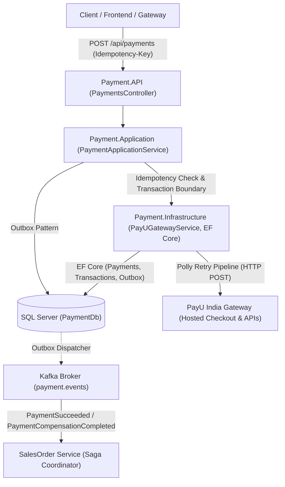
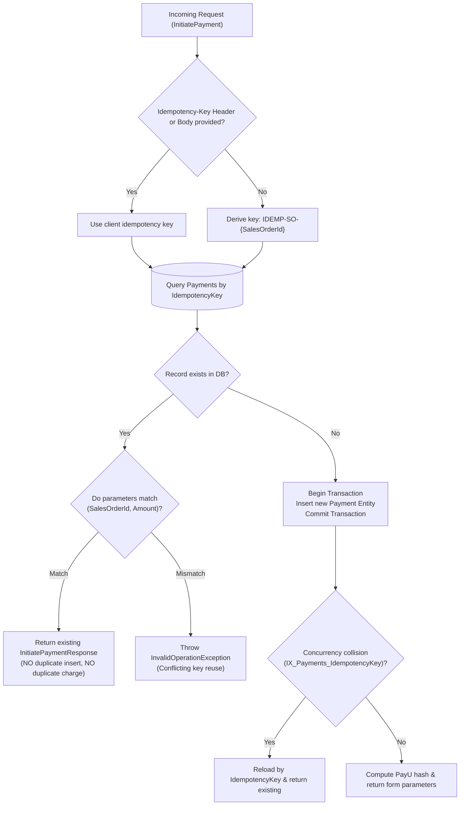

# Payment Service: PayU Gateway, Idempotency & Safe Retry Architecture

This document provides complete technical documentation for the **Payment Service** in `Vehical_Ecom`. It covers the **PayU Gateway integration**, **Idempotency protection**, **Polly-based safe retry logic**, **Transactional Outbox**, and **Saga compensation coordination** with the `SalesOrder` service.

---

## 1. Architectural Overview

The Payment Service follows Clean Architecture with strict transaction boundaries:



---

## 2. PayU Gateway Integration

### 2.1 Configuration
Defined in `appsettings.json` and bound to `PayUOptions.cs`:

| Key | Description | Sandbox Default |
| :--- | :--- | :--- |
| `PayU:MerchantKey` | Merchant account identifier | `payu_test_key` |
| `PayU:MerchantSalt` | Secret salt for SHA-512 signing | `payu_test_salt` |
| `PayU:PaymentUrl` | PayU Hosted Checkout redirect URL | `https://test.payu.in/_payment` |
| `PayU:VerifyPaymentUrl` | Server-to-server transaction verification API | `https://test.payu.in/merchant/postservice?form=2` |
| `PayU:RefundUrl` | Gateway refund command API | `https://test.payu.in/merchant/postservice?form=2` |

### 2.2 SHA-512 Cryptographic Signatures
Implemented in `PayUHashService.cs`:

1. **Payment Request Hash (Client $\rightarrow$ PayU)**:
   $$\text{sha512}(\text{key} \mid \text{txnid} \mid \text{amount} \mid \text{productinfo} \mid \text{firstname} \mid \text{email} \mid \text{udf1..5} \mid\mid\mid\mid\mid\mid \text{SALT})$$
2. **Response Hash Verification (PayU $\rightarrow$ Merchant)**:
   - *Without Additional Charges*:
     $$\text{sha512}(\text{SALT} \mid \text{status} \mid\mid\mid\mid\mid\mid \text{udf5..1} \mid \text{email} \mid \text{firstname} \mid \text{productinfo} \mid \text{amount} \mid \text{txnid} \mid \text{key})$$
   - *With Additional Charges (convenience fee)*:
     $$\text{sha512}(\text{additionalCharges} \mid \text{SALT} \mid \text{status} \mid\mid\mid\mid\mid\mid \text{udf5..1} \mid \text{email} \mid \text{firstname} \mid \text{productinfo} \mid \text{amount} \mid \text{txnid} \mid \text{key})$$
3. **Verify Payment Hash (`verify_payment`)**:
   $$\text{sha512}(\text{key} \mid \text{"verify\_payment"} \mid \text{txnid} \mid \text{SALT})$$
4. **Refund Command Hash (`cancel_refund_transaction`)**:
   $$\text{sha512}(\text{key} \mid \text{"cancel\_refund\_transaction"} \mid \text{mihpayid} \mid \text{SALT})$$

---

## 3. Idempotency Architecture

To prevent duplicate charges, double orders, or repeated refunds when clients reconnect, retry, or double-click:



### 3.1 Idempotency Rules Across Endpoints

| Endpoint | Idempotency Identifier | Idempotency Behavior |
| :--- | :--- | :--- |
| `POST /api/payments` (`initiate`) | `Idempotency-Key` (Header or Body) | Returns cached transaction parameters if key exists. Rejects conflicting requests. Protected by DB index `IX_Payments_IdempotencyKey`. |
| `POST /api/payments/callback` | `txnid` (PayU Transaction ID) | If status is already `Captured`, `Refunded`, or `Failed`, returns immediately and **suppresses duplicate Outbox events**. |
| `POST /api/payments/refund` | `SagaId` or `IdempotencyKey` | If refund was already completed, returns existing refund record without calling PayU refund API again. |

---

## 4. Safe Retry Logic for Transient Failures

### 4.1 Polly 8 Resilience Pipeline
External HTTP calls to PayU are wrapped in a resilient pipeline defined in `PayUResiliencePolicy.cs`:

```csharp
public static ResiliencePipeline<HttpResponseMessage> CreateHttpRetryPipeline(ILogger? logger = null)
{
    return new ResiliencePipelineBuilder<HttpResponseMessage>()
        .AddRetry(new RetryStrategyOptions<HttpResponseMessage>
        {
            MaxRetryAttempts = 3,
            Delay = TimeSpan.FromMilliseconds(500),
            BackoffType = DelayBackoffType.Exponential,
            UseJitter = true,
            ShouldHandle = new PredicateBuilder<HttpResponseMessage>()
                .Handle<HttpRequestException>()
                .Handle<TimeoutException>()
                .HandleResult(r => (int)r.StatusCode >= 500 || r.StatusCode == HttpStatusCode.RequestTimeout),
            OnRetry = args => { /* Structured Warning Log */ }
        })
        .Build();
}
```

### 4.2 Safe Retry Invariants
To prevent duplicate operations during retries:

1. **Recreation of HTTP Request**: Every retry allocates a fresh `HttpRequestMessage` instance inside the execution delegate, preventing `.NET`'s `InvalidOperationException: The request message was already sent`.
2. **Deterministic Verification Tokens**: `verify_payment` uses the constant `txnid`. Verification is read-only and idempotent.
3. **Deterministic Refund Tokens**: PayU refund commands send:
   - `var1` = `gatewayPaymentId` (`mihpayid`)
   - `var2` = `refundReference` (PayU uses `var2` as the merchant refund idempotency key)
   - `var3` = `amount`
   If the HTTP call drops and retries, PayU recognises `var2` and returns the existing queued refund without executing a duplicate refund.
4. **Database Retry on Failure**: SQL Server transient connection failures, failovers, and deadlocks are handled via EF Core's execution strategy in `DependencyInjection.cs`:
   ```csharp
   options.UseSqlServer(connectionString, sqlOptions =>
   {
       sqlOptions.EnableRetryOnFailure(
           maxRetryCount: 5,
           maxRetryDelay: TimeSpan.FromSeconds(10),
           errorNumbersToAdd: null);
   });
   ```

---

## 5. Transactional Outbox & Saga Patterns

### 5.1 Transactional Outbox Pattern
Prevents the **dual-write problem** by ensuring that entity state and event payloads are committed in a single atomic database transaction:

```csharp
await _unitOfWork.BeginTransactionAsync(ct);

// 1. Mutate Domain Entity
payment.MarkSuccess(mihpayId, mode, bankRef);

// 2. Enqueue Event in Outbox
await _outboxWriter.AddAsync(
    eventType: "PaymentSucceeded",
    aggregateId: payment.SalesOrderId.ToString(),
    payload: new PaymentSucceededPayload(payment.SalesOrderId, payment.Amount, payment.Currency),
    ct: ct);

// 3. Single Atomic Commit
await _repository.SaveChangesAsync(ct);
await _unitOfWork.CommitTransactionAsync(ct);
```

### 5.2 Saga Compensation (Order Cancellation)
When an order is cancelled after payment capture:
1. `SalesOrder` records an `OrderCancellationSaga` entity with `PaymentCompensationRequired = true`.
2. Calls `Payment.API` `POST /api/payments/refund` with `SagaId`.
3. `PaymentApplicationService` processes the refund via PayU, records `PaymentRefund`, and commits a `PaymentCompensationCompleted` outbox message.
4. `SalesOrder` consumes `PaymentCompensationCompleted`, checks idempotency via `ProcessedIntegrationEvents`, sets `saga.PaymentCompensationCompleted = true`, and transitions the order to `Cancelled`.

---

## 6. Verification and Testing

The implementation is verified by 24 unit tests in `Payment.Tests`:

| Test Class | Focus | Tests |
| :--- | :--- | :--- |
| `PayUHashServiceTests.cs` | SHA-512 calculation, tamper rejection, response hash | 6 |
| `PaymentApplicationServiceTests.cs` | Initiation, callback, saga refund, idempotency duplicate prevention, conflict detection | 10 |
| `PaymentsControllerTests.cs` | API controller routing, `Idempotency-Key` header injection | 5 |
| `PayUResiliencePolicyTests.cs` | Transient 503 recovery, `HttpRequestException` retry, 400 fast-fail | 3 |

Run tests anytime with:
```bash
dotnet test Services\Payment\Payment.Tests
```
All **24 tests** execute in ~1 second.
